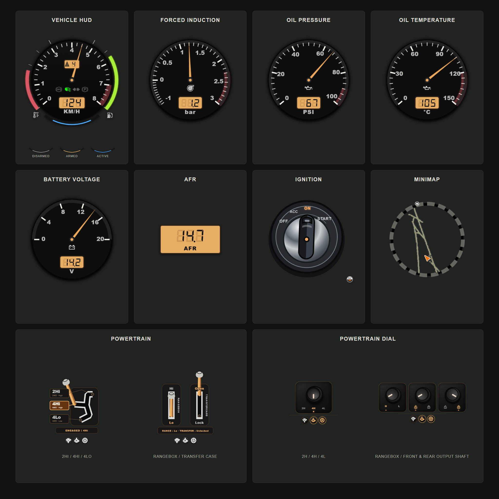

# MW05 BeamNG UI Apps

This project was created using artificial intelligence (AI), under human direction.

Version **0.2.0** — BeamNG.drive UI apps inspired by Need for Speed: Most Wanted (2005).

See the [changelog](CHANGELOG.md) for the latest fixes.

- `MW05 Vehicle HUD`: vector tachometer, speed in KM/H or MPH, gear indicator, fuel/battery indicators, temperature, and NOS. Click the speed unit to switch between KM/H and MPH.
- `MW05 Forced Induction`: turbo/supercharger boost gauge with a responsive needle and a decimal readout in PSI or bar (click the unit to switch), available when the vehicle exposes `boost` and `boostMax`.
- `MW05 Oil Pressure`: the same gauge design for oil pressure, with a decimal readout in PSI or bar when the vehicle exposes an oil pressure value.
- `MW05 Oil Temperature`: engine oil temperature gauge with Celsius/Fahrenheit display.
- `MW05 Battery Voltage`: battery voltage gauge with a decimal readout.
- `MW05 AFR`: digital air-fuel ratio display.
- `MW05 Ignition`: animated ignition key driven by the vehicle's ignition state.
- `MW05 Minimap`: a standalone app that uses BeamNG's native minimap engine for the map, roads, vehicle position, and orientation, with a dark circular design and a segmented ring.
- `MW05 Powertrain`: powertrain controls with functions that depend on the vehicle.
- `MW05 Powertrain Dial`: compact MW05-style controls with a 2H / 4H / 4Lo dial, Hi/Lo and Open/Lock selectors when the vehicle exposes them, and native differential and driven-axle buttons adapted to the dark and orange design.

## Installation

Download `MW05BeamNG.zip` from the [latest release](https://github.com/deliciousTic-Tac/Beamng-MW05-hud/releases/latest) and place it in `beamng\current\mods`, the `mods` folder inside your active BeamNG user folder. Keep the ZIP intact; do not extract it.

Launch BeamNG.drive, open Freeroam, then select `ESC` → `UI Apps` to add the MW05 apps. See [INSTALL.md](INSTALL.md) for details.

## Data Sources

The HUD subscribes to BeamNG's `electrics` stream and uses `wheelspeed`, `rpmTacho`, `gear`, `gearIndex`, `fuel`, and `oil`. Optional values are detected in the received object. The Forced Induction app uses `boost` and `boostMax`, which BeamNG reports in PSI. The Oil Pressure app accepts `oilPressure` in bar, as well as explicit variants exposed by certain vehicles or mods. AFR, oil pressure and battery voltage may use fallback estimates when measured values are unavailable; see the note below.

## Development

The application sources are under `ui/modules/apps/`. Release ZIPs preserve this directory structure at the archive root, with `/` path separators.

Build with PowerShell 7: `./build.ps1`. Run the local regression checks with Node.js: `node tests/regression.js`.

The builder bundles `lib/runtime.js` into each application script, so every installed app is self-contained. Build the ZIP before installing; raw source `app.js` files require this shared runtime. The shared code handles coalesced rendering, bounded SVG caches, vehicle callback guards and reference-counted stylesheets. Git files, tests and development files are excluded from the package.

Lua requests use the scoped `MW05LuaResponse` event rather than BeamNG's callback registry. Each topic has at most one pending request, a two-second timeout and exponential retry delays up to eight seconds. The shared budget allows eight queries plus two reserved command slots. Timeouts, vehicle changes and app removal release pending entries; late replies are ignored. Queries run inside `pcall`, and dynamically inserted names use Lua 5.1 literals instead of JSON escaping.

SVG templates are compiled per instance: definition IDs and local references receive a unique prefix. Stylesheets reference inherited custom properties for that instance's filters and gradients.

Additional development checks: `node tests/powertrain_lua.js` executes generated commands and response envelopes in LuaJIT (requires `lupa==2.6`; set `MW05_LUA_PYTHON` and `MW05_LUA_MODULES` if needed). `node tests/svg_instances.cjs` checks simultaneous app instances in a headless Microsoft Edge browser. Install Playwright, or use `CODEX_NODE_MODULES` to locate it, and set `BEAMNG_UI_PATH` to the `ui` directory of your BeamNG installation. `MW05_SVG_SCREENSHOT` optionally specifies a screenshot output path.

AFR, oil pressure and battery voltage retain their existing fallback estimates when a vehicle does not expose real values. These estimates are not physical measurements; this maintenance update does not change their formulas.

The small static `preview.html` preview lets you check the visual layout without launching the game; it does not replace in-game testing of BeamNG streams and events. The minimap delegates rendering to the game's native backend to maintain accurate positioning.
